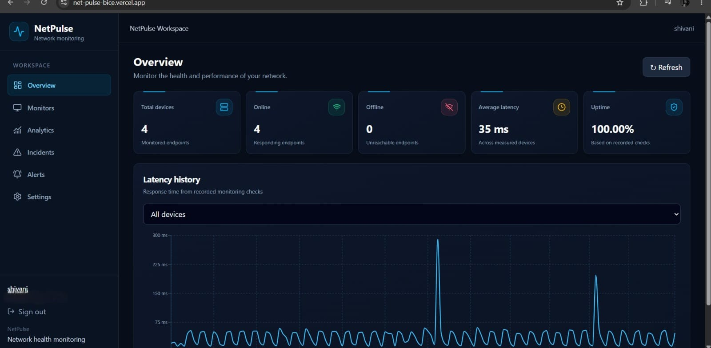
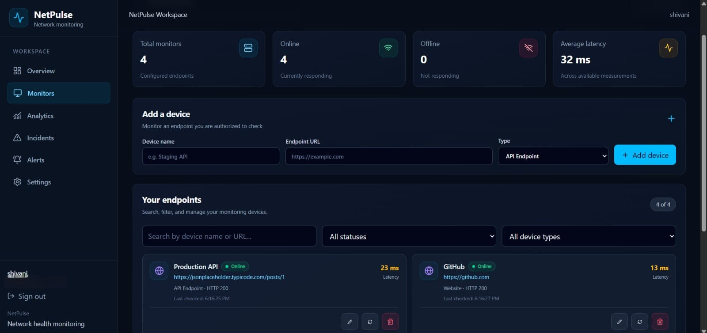
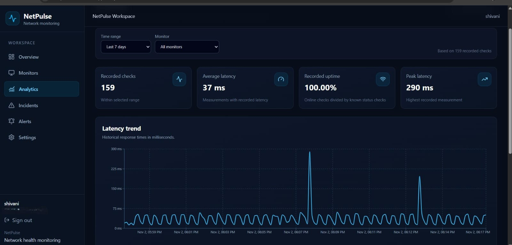
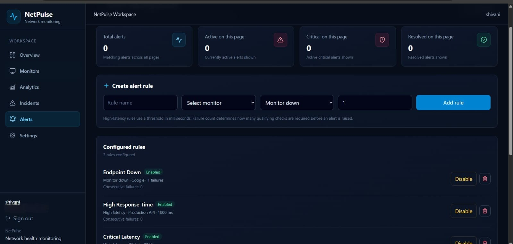
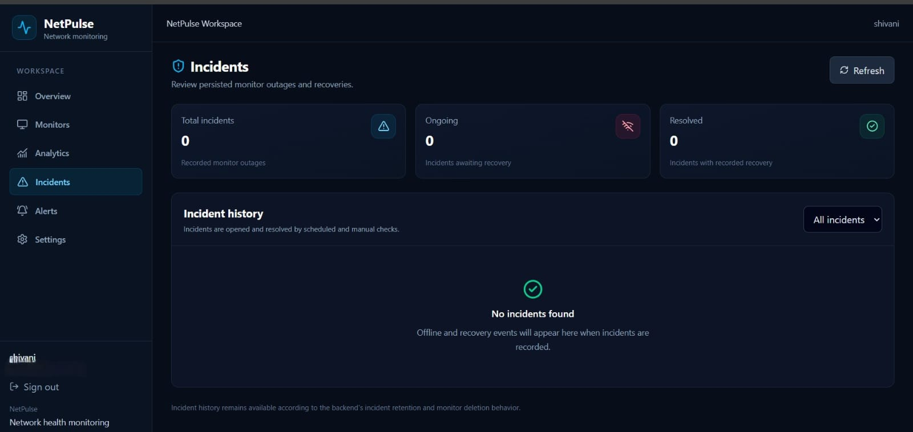
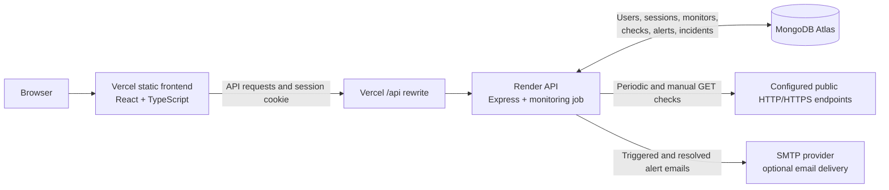

# NetPulse

### Website and endpoint monitoring with a React dashboard and Node.js API

## Table of contents

- [Project overview](#project-overview)
- [Project screenshots](#project-screenshots)
- [Live demo](#live-demo)
- [Features](#features)
- [Technology stack](#technology-stack)
- [System architecture](#system-architecture)
- [Project structure](#project-structure)
- [Installation and local setup](#installation-and-local-setup)
- [Environment variables](#environment-variables)
- [API documentation](#api-documentation)
- [Monitoring workflow](#monitoring-workflow)
- [Testing](#testing)
- [Deployment](#deployment)
- [Security](#security)
- [Possible next steps](#possible-next-steps)
- [Author](#author)

## Project overview

I built NetPulse to put the endpoint-monitoring workflow in one place: configure a website or HTTP endpoint, collect recurring checks, and review the results in a dashboard. It addresses the gap between a one-off availability check and having a useful record of status, response time, alerts, and recovery.

The backend schedules a monitoring cycle every 30 seconds while it is running. The dashboard shows each monitor's latest result alongside its history, analytics, alert rules, and incidents. The UI refreshes data every 10 seconds by default; that interval can be set to 10, 30, or 60 seconds. This project checks HTTP endpoints rather than collecting host-level CPU, memory, or operating-system metrics.

## Project Screenshots

### Dashboard overview



*A summary of monitor health, uptime, average latency, and recent response-time history.*

### Monitor management



*Manage monitored endpoints and review their latest status and response times.*

### Analytics



*Explore recorded checks, uptime, and latency trends over a selected time range.*

### Alerts and rules



*Configure alert rules and review triggered or resolved alerts.*

### Incident history



*Review monitor outages and their recovery status.*

## Live demo

- **Frontend:** [net-pulse-bice.vercel.app](https://net-pulse-bice.vercel.app)
- **Backend API:** [netpulse-j2sw.onrender.com](https://netpulse-j2sw.onrender.com)

The frontend sends production API requests through the `/api` proxy configured in `Frontend/vercel.json`.

## Features

- **Monitor websites and endpoints:** add, edit, remove, inspect, and manually check public HTTP or HTTPS URLs. Endpoint validation rejects embedded credentials and local or private network targets.
- **Track availability and latency:** checks record Online, Offline, or Unknown status, response time when available, HTTP status, check time, and error details.
- **Review monitoring history:** inspect recent results per monitor. The device history endpoint returns up to 500 entries; analytics history supports date ranges and pagination.
- **Explore analytics:** see monitor counts by status, uptime, average latency, check totals, and per-device statistics for a selected period.
- **Configure alert rules:** create `MonitorDown` or `HighLatency` rules, set a failure count or latency threshold, and enable or disable rules.
- **Follow alert lifecycle:** review active and resolved alerts. Consecutive qualifying failures can trigger an alert; a later recovery resolves it.
- **Track incidents:** an offline check opens or updates an incident. An online check resolves the open incident.
- **Use account-backed sessions:** register and sign in; monitors and related records are scoped to the authenticated account.
- **Receive email notifications:** the backend can send SMTP email when an alert is triggered or resolved. Delivery requires SMTP configuration and network access; see [deployment limitations](#deployment).
- **Use a responsive dashboard:** pages cover overview, monitors, analytics, alerts, incidents, and account settings.

## Technology stack

| Area | Technologies |
| --- | --- |
| Frontend | React 19, TypeScript 6, Vite 8, React Router, Axios, Tailwind CSS 4, Recharts, Lucide React |
| Backend | Node.js, Express 5, Mongoose 9, Node.js `fetch`, built-in crypto and DNS APIs |
| Database | MongoDB Atlas (MongoDB accessed through Mongoose) |
| Authentication and security | scrypt password hashing, random session tokens stored as SHA-256 hashes, HttpOnly/Secure cookies in production, CSRF token validation, origin checks, authentication rate limiting, endpoint DNS/IP validation |
| Email | Nodemailer with SMTP transport |
| Deployment | Vercel frontend with `/api` rewrite proxy; Render backend; MongoDB Atlas database |

## System architecture



In production, the browser calls `/api` on Vercel, which rewrites requests to Express on Render. The API reads and writes users, sessions, monitors, checks, alerts, and incidents in MongoDB Atlas through Mongoose. A background interval checks endpoints and persists each result; alert and incident services process those results, and the email service can send notifications through SMTP.

## Project structure

```text
NetPulse/
├── Backend/
│   ├── config/          # MongoDB connection
│   ├── controllers/     # HTTP request handlers
│   ├── jobs/            # Background monitoring interval
│   ├── middleware/      # Authentication, CSRF, rate limiting, errors
│   ├── models/          # Mongoose schemas
│   ├── routes/          # Express route definitions
│   ├── services/        # Auth, monitoring, alerts, analytics, email
│   ├── tests/           # Node.js test-runner tests
│   ├── utils/           # Cookie helpers
│   ├── .env.example     # Safe backend environment template
│   ├── app.js           # Express middleware and route mounting
│   └── server.js        # Database startup and monitor job lifecycle
├── Frontend/
│   ├── public/          # Static public assets
│   ├── src/
│   │   ├── assets/      # UI assets
│   │   ├── components/  # Auth, dashboard, device, and layout components
│   │   ├── hooks/       # React data hooks
│   │   ├── pages/       # Login, register, overview, and dashboard pages
│   │   ├── services/    # Axios API clients
│   │   ├── types/       # TypeScript data types
│   │   └── utils/       # Display and device helpers
│   ├── vercel.json      # Production /api rewrite
│   └── vite.config.ts   # Vite, React, and Tailwind plugins
└── screenshots/         # README screenshots
    ├── dashboard.png.jpeg
    ├── monitors.png.jpeg
    ├── analytics.png.jpeg
    ├── alerts.png.jpeg
    └── incidents.png.jpeg
```

## Installation and local setup

### Prerequisites

- Node.js 20.19+ or 22.12+ (required by the installed Vite version and Mongoose).
- npm.
- A MongoDB connection string with network access from the backend.
- Optional SMTP credentials if you want to test alert email delivery.

### Clone the repository

```bash
git clone https://github.com/ShivaniiYadav28/NetPulse.git
cd NetPulse
```

### Configure and start the backend

Create `Backend/.env` using the [backend environment variable reference](#environment-variables). Do not commit this file.

```bash
cd Backend
npm install
npm run dev
```

The backend defaults to port `5000`. It connects to MongoDB before accepting requests and starts the monitoring job after startup.

### Start the frontend

In another terminal:

```bash
cd Frontend
npm install
npm run dev
```

Vite serves the app locally. In development, the frontend API client targets `http://localhost:5000/api`; in production it uses the same-origin `/api` proxy.

## Environment variables

### Backend

Create `Backend/.env` with the variables needed for your environment. This is a safe template; replace placeholders locally and keep the real file out of version control.

```dotenv
PORT=5000
MONGODB_URI=mongodb+srv://<username>:<password>@<cluster-host>/netpulse-demo?retryWrites=true&w=majority
FRONTEND_URL=http://localhost:5173
AUTH_SESSION_TTL_DAYS=7

# Optional: configure all SMTP values to enable email delivery.
SMTP_HOST=<smtp-host>
SMTP_PORT=587
SMTP_SECURE=false
SMTP_USER=<smtp-username>
SMTP_PASS=<smtp-password>
SMTP_FROM=<verified-sender-address>
```

| Variable | Purpose |
| --- | --- |
| `PORT` | Backend HTTP port; defaults to `5000` if unset. |
| `MONGODB_URI` | MongoDB connection string. For the deployed application, use the Atlas database configured for production (`netpulse-demo`). |
| `FRONTEND_URL` | Frontend origin used by CORS and checked against a supplied `Origin` header. Use the local Vite origin in development and the Vercel origin in production. |
| `AUTH_SESSION_TTL_DAYS` | Session lifetime in days; must be an integer from 1 through 30. Defaults to 7. |
| `SMTP_HOST`, `SMTP_PORT`, `SMTP_SECURE`, `SMTP_USER`, `SMTP_PASS` | Nodemailer SMTP connection settings. Port defaults to 587; secure mode is enabled only when `SMTP_SECURE=true`. |
| `SMTP_FROM` | Sender address required to send an email. |

### Frontend

The current frontend does not read a frontend `.env` variable. Development and production API base URLs are selected in `Frontend/src/services/api.ts`; production routing is configured in `Frontend/vercel.json`.

```dotenv
# No frontend environment variables are currently required.
```

## API documentation

All routes below are mounted under `/api`. Except for health and the listed public auth endpoints, application data routes require a valid session. State-changing authenticated routes require the session CSRF token. Auth routes that check request origins compare a supplied `Origin` header with the configured frontend origin.

### Health

| Method | Route | Description | Access |
| --- | --- | --- | --- |
| `GET` | `/health` | Reports API health and whether Mongoose is connected. | Public |

### Authentication

| Method | Route | Description | Access |
| --- | --- | --- | --- |
| `POST` | `/auth/register` | Creates an account and starts a session. | Public; rate limited; origin checked |
| `POST` | `/auth/login` | Verifies credentials and starts a session. | Public; rate limited; origin checked |
| `GET` | `/auth/me` | Returns the current user and CSRF token. | Authenticated |
| `PATCH` | `/auth/alert-email` | Updates the account’s alert recipient address or addresses. | Authenticated; CSRF and origin checked |
| `POST` | `/auth/logout` | Ends the current session and clears the cookie. | Authenticated; CSRF and origin checked |

### Devices

| Method | Route | Description |
| --- | --- | --- |
| `GET` | `/devices` | Lists the authenticated user’s monitors. |
| `GET` | `/devices/:id` | Gets one monitor. |
| `POST` | `/devices` | Adds a monitor after endpoint validation. |
| `PUT` | `/devices/:id` | Updates monitor name, address, or type. |
| `DELETE` | `/devices/:id` | Removes the monitor and its related user-owned history, alerts, rules, and incidents in a database transaction. |
| `GET` | `/devices/:id/history` | Gets up to 500 recent history entries for a monitor. |
| `POST` | `/devices/:id/check` | Runs and persists a manual check. |

### Alerts and alert rules

| Method | Route | Description |
| --- | --- | --- |
| `GET` | `/alerts` | Lists alerts; supports `status`, `type`, `page`, and `limit` query parameters. |
| `GET` | `/alerts/:id` | Gets one alert. |
| `GET` | `/alerts/rules` | Lists the user’s alert rules. |
| `POST` | `/alerts/rules` | Creates a `MonitorDown` or `HighLatency` rule. |
| `PATCH` | `/alerts/rules/:id` | Updates a rule, including its enabled state and thresholds. |
| `DELETE` | `/alerts/rules/:id` | Deletes a rule and resolves its active alerts. |

### Incidents

| Method | Route | Description |
| --- | --- | --- |
| `GET` | `/incidents` | Lists incidents; optional `status` is `Open` or `Resolved`. |
| `GET` | `/incidents/summary` | Returns open, resolved, and total incident counts. |

### Analytics

| Method | Route | Description |
| --- | --- | --- |
| `GET` | `/analytics/overview` | Returns account monitor, incident, uptime, and latency summary. Accepts optional `from` and `to` dates. |
| `GET` | `/analytics/devices/:id` | Returns per-device status and analytics for a date range. |
| `GET` | `/analytics/devices/:id/history` | Returns paginated device history for a date range; accepts `from`, `to`, `page`, and `limit`. |

Analytics date ranges default to the most recent 24 hours when `from` and `to` are not provided.

## Monitoring workflow

1. A user adds an HTTP or HTTPS endpoint. Validation rejects embedded URL credentials, local or internal hostnames, and DNS results that resolve to private or reserved addresses.
2. The monitoring job runs once at startup, then schedules cycles every 30 seconds. It checks devices sequentially and avoids overlapping cycles, so a cycle can take longer than 30 seconds when there are many or slow endpoints. Users can also run a manual check.
3. Each check sends a `GET` request with a five-second timeout and does not follow redirects. HTTP responses from 200 through 399 are **Online**; responses from 400 through 599 are **Offline**. DNS failures, timeouts, and recognized network errors are **Offline**. Other unclassified errors are **Unknown**.
4. The result updates the device's latest status and is saved in monitor history. The checking flow trims history to the latest 500 entries per device.
5. An Offline result opens or updates an incident. An Online result resolves the open incident; an Unknown result leaves the incident state unchanged.
6. Enabled rules evaluate each result. `MonitorDown` matches Offline checks. `HighLatency` matches Online checks at or above its configured threshold. Rules can require consecutive failures before opening an alert. When a rule condition no longer matches, its active alert is resolved.
7. When an alert is created or resolved, the backend attempts to send email if a recipient and SMTP configuration are available and the mail server is reachable.

## Testing

Backend tests use Node.js’s built-in test runner:

```bash
cd Backend
npm test
```

The suite includes alert processing and authentication tests for password hashing, registration, login, invalid credentials, and session verification.

## Deployment

### Frontend on Vercel

Deploy the `Frontend` directory as the Vite frontend. `Frontend/vercel.json` rewrites `/api/:path*` to the Render backend. The frontend API client uses `/api` in production, so browser requests remain on the Vercel origin.

### Backend on Render

Deploy `Backend` as a Node.js web service. Its start script is `npm start` (`node server.js`). Set the backend environment variables in the Render service dashboard, including:

- `MONGODB_URI` targeting the intended Atlas database (`netpulse-demo` in the described production setup).
- `FRONTEND_URL` set to `https://net-pulse-bice.vercel.app`.
- `AUTH_SESSION_TTL_DAYS` if a non-default session lifetime is desired.
- SMTP variables if notification email is expected and the selected Render plan and SMTP provider allow delivery.

### MongoDB Atlas

Create or select the `netpulse-demo` database in Atlas, configure a database user, and allow the Render backend to reach the cluster through Atlas network access settings. Store the full connection string only in Render’s environment configuration and local ignored `.env` files; never commit it.

### Hosting plan limitations

The exact behavior depends on the selected Render plan. **Render Free web services spin down after 15 minutes without inbound traffic** and may take about a minute to start again after the next request. Since this project runs monitoring as an in-process interval, checks pause while that backend service is spun down and are not continuous on that plan. Free web services also have monthly instance-hour limits. See [Render’s free service limitations](https://render.com/docs/free).

Render documents that **Free web services cannot send outbound traffic on SMTP ports 25, 465, or 587**. The project currently sends email through SMTP using Nodemailer, so SMTP delivery on those ports will not work from a Render Free service. Use a plan and mail delivery setup that permit SMTP, or implement an email API integration as a future improvement. Email delivery also depends on valid sender/provider configuration. See [Render’s free service limitations](https://render.com/docs/free).

## Security

- Passwords are hashed with Node.js `scrypt`; login compares derived hashes using a timing-safe comparison.
- Session tokens are cryptographically random. Only SHA-256 token hashes are stored in MongoDB, and sessions have an expiry.
- Production session cookies use the `__Host-` prefix with `Secure`, `HttpOnly`, `Path=/`, and `SameSite=Lax` attributes.
- State-changing authenticated requests require a CSRF token checked with a timing-safe comparison. Auth routes compare a supplied `Origin` header with the configured frontend origin; login and registration are rate limited.
- Data routes scope monitors and related records to the authenticated user. Endpoint validation blocks local/private targets and URLs containing embedded credentials to reduce server-side request forgery risk.
- Do not commit `.env` files or paste secrets into source code, issues, or logs. Use your deployment provider’s secret environment settings for production credentials.

## Possible next steps

These are possible extensions, not features in the current implementation:

- Move periodic checks to a durable worker or scheduler so monitoring continues independently of web service sleep and restarts.
- Add an email delivery provider API option and observable delivery status/retry handling.
- Add automated browser-level tests and integration tests against an isolated test database.
- Add account recovery and multi-factor authentication.
- Add configurable history retention and longer-range analytics for larger deployments.

## Author

[GitHub](https://github.com/ShivaniiYadav28)
