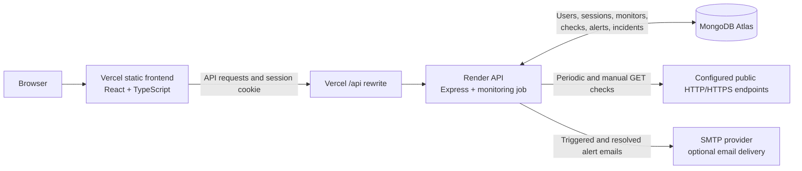

# NetPulse

**A full-stack website and endpoint monitoring dashboard for tracking availability, latency, incidents, and alerts.**

[](https://react.dev/)
[](https://www.typescriptlang.org/)
[](https://nodejs.org/)
[](https://www.mongodb.com/atlas)

## Table of contents

- [Project overview](#project-overview)
- [Live demo](#live-demo)
- [Key features](#key-features)
- [Screenshots](#screenshots)
- [Technology stack](#technology-stack)
- [System architecture](#system-architecture)
- [Project structure](#project-structure)
- [Installation and local setup](#installation-and-local-setup)
- [Environment variables](#environment-variables)
- [API documentation](#api-documentation)
- [Monitoring workflow](#monitoring-workflow)
- [Testing](#testing)
- [Deployment](#deployment)
- [Security](#security)
- [Future improvements](#future-improvements)
- [Author](#author)

## Project overview

NetPulse is a full-stack monitoring dashboard for keeping an eye on websites and other HTTP or HTTPS endpoints. It periodically checks configured endpoints, records their availability and response times, and brings current status, recent history, analytics, alerts, and incidents together in one interface.

When a site is unavailable or responds more slowly than expected, teams need more than a one-time check: they need a record of what happened, when it happened, and whether it recovered. NetPulse provides that operational view with per-account monitors, historical check data, configurable alert rules, and incident tracking. Its dashboard is designed to make service health and recent problems easy to scan.

Checks run every 30 seconds while the backend process is running. This is periodic monitoring, not a WebSocket or push-based real-time feed.

## Live demo

- **Frontend:** [net-pulse-bice.vercel.app](https://net-pulse-bice.vercel.app)
- **Backend API:** [netpulse-j2sw.onrender.com](https://netpulse-j2sw.onrender.com)

The frontend sends production API requests through the `/api` proxy configured in `Frontend/vercel.json`.

## Key features

- **Account authentication:** registration and login with persistent, database-backed sessions.
- **Endpoint monitoring:** add, edit, remove, inspect, and manually check HTTP/HTTPS endpoints.
- **Availability and latency:** checks store online/offline/unknown status, response time, HTTP status, last check time, and error details where available.
- **Monitoring history:** review per-device check history. The regular device history endpoint retains up to 500 recent entries per monitor; analytics also supports date ranges and pagination.
- **Dashboard statistics and analytics:** view monitor counts by status, uptime percentage, average latency, incident counts, and per-device check statistics.
- **Alert rules:** configure `MonitorDown` and `HighLatency` rules, including failure counts, thresholds, enabled state, and monitored device.
- **Alert management:** view active and resolved alerts, filter by status and type, and inspect individual alerts.
- **Incident lifecycle:** offline checks open or update an incident; a later online check resolves it.
- **Email notifications:** newly triggered alerts and resolved alerts can send email using configured SMTP. Delivery depends on valid SMTP settings and host network access; see [deployment limitations](#deployment).
- **Responsive dashboard:** React pages provide overview, monitors, analytics, alerts, incidents, and account settings.
- **Account-scoped data:** monitor and related records are filtered by the authenticated account.

## Screenshots

Screenshots are not currently included in the repository. Add actual captures before replacing these notes with Markdown image links.

- `dashboard-overview.png` — overview cards and service status
- `monitors-list.png` — configured monitors and latest check results
- `analytics.png` — uptime and latency analytics
- `alerts-and-incidents.png` — alert rules, alert state, and incident history

## Technology stack

| Area | Technologies verified in the project |
| --- | --- |
| Frontend | React 19, TypeScript 6, Vite 8, React Router, Axios, Tailwind CSS 4, Recharts, Lucide React |
| Backend | Node.js, Express 5, Mongoose 9, Node.js `fetch`, built-in crypto and DNS APIs |
| Database | MongoDB Atlas (MongoDB accessed through Mongoose) |
| Authentication and security | scrypt password hashing, random session tokens stored as SHA-256 hashes, HttpOnly/Secure cookies in production, CSRF token validation, origin checks, authentication rate limiting, endpoint DNS/IP validation |
| Email | Nodemailer with SMTP transport |
| Deployment | Vercel frontend with `/api` rewrite proxy; Render backend; MongoDB Atlas database |

## System architecture



The frontend calls `/api` in production. Vercel rewrites those requests to the Render API. Express uses Mongoose to read and write application data in MongoDB Atlas. A backend interval checks monitor endpoints and persists each result; alert and incident services process the result and may send SMTP notifications.

## Project structure

```text
NetPulse/
├── Backend/
│   ├── config/          # MongoDB connection
│   ├── controllers/     # HTTP request handlers
│   ├── jobs/            # Background monitoring interval
│   ├── middleware/      # Auth, CSRF, rate limiting, error handling
│   ├── models/          # Mongoose schemas
│   ├── routes/          # Express route definitions
│   ├── services/        # Auth, monitoring, alerts, analytics, email
│   ├── tests/           # Node.js test-runner tests
│   ├── utils/           # Cookie helpers
│   ├── .env.example     # Backend variable names and placeholders
│   ├── app.js            # Express middleware and route mounting
│   └── server.js         # Database startup and monitor job lifecycle
└── Frontend/
    ├── public/           # Static public assets
    ├── src/
    │   ├── assets/       # UI assets
    │   ├── components/   # Auth, dashboard, device, layout components
    │   ├── hooks/        # React data hooks
    │   ├── pages/        # Login, register, overview, monitor, and other pages
    │   ├── services/     # Axios API clients
    │   ├── types/        # TypeScript data types
    │   └── utils/        # Display and device helpers
    ├── vercel.json       # Production /api rewrite
    └── vite.config.ts    # Vite, React, and Tailwind plugins
```

## Installation and local setup

### Prerequisites

- Node.js compatible with the project dependencies (Node.js 20 or newer is recommended).
- npm.
- A MongoDB connection string with network access from the backend.
- Optional SMTP credentials if you want to test alert email delivery.

### Clone the repository

```bash
git clone <repository-url>
cd NetPulse
```

Replace `<repository-url>` with the repository URL you use.

### Configure and start the backend

Create `Backend/.env` using the [backend environment variable reference](#environment-variables). Do not commit this file.

```bash
cd Backend
npm install
npm run dev
```

The backend defaults to port `5000`. It connects to MongoDB before accepting requests and starts the monitoring job after startup.

### Start the frontend

In another terminal:

```bash
cd Frontend
npm install
npm run dev
```

Vite serves the app locally. In development, the frontend API client targets `http://localhost:5000/api`; in production it uses the same-origin `/api` proxy.

## Environment variables

### Backend

Create `Backend/.env` with the variables needed for your environment. This is a safe template; replace placeholders locally and keep the real file out of version control.

```dotenv
PORT=5000
MONGODB_URI=mongodb+srv://<username>:<password>@<cluster-host>/netpulse-demo?retryWrites=true&w=majority
FRONTEND_URL=http://localhost:5173
AUTH_SESSION_TTL_DAYS=7

# Optional: configure all SMTP values to enable email delivery.
SMTP_HOST=<smtp-host>
SMTP_PORT=587
SMTP_SECURE=false
SMTP_USER=<smtp-username>
SMTP_PASS=<smtp-password>
SMTP_FROM=<verified-sender-address>
```

| Variable | Purpose |
| --- | --- |
| `PORT` | Backend HTTP port; defaults to `5000` if unset. |
| `MONGODB_URI` | MongoDB connection string. For the deployed application, use the Atlas database configured for production (`netpulse-demo`). |
| `FRONTEND_URL` | Exact allowed frontend origin used by CORS and origin validation. Set to the local Vite origin in development and the deployed Vercel origin in production. |
| `AUTH_SESSION_TTL_DAYS` | Session lifetime in days; must be an integer from 1 through 30. Defaults to 7. |
| `SMTP_HOST`, `SMTP_PORT`, `SMTP_SECURE`, `SMTP_USER`, `SMTP_PASS` | Nodemailer SMTP connection settings. Port defaults to 587; secure mode is enabled only when `SMTP_SECURE=true`. |
| `SMTP_FROM` | Sender address required to send an email. |

### Frontend

The current frontend does not read a frontend `.env` variable. Development and production API base URLs are selected in `Frontend/src/services/api.ts`; production routing is configured in `Frontend/vercel.json`.

```dotenv
# No frontend environment variables are currently required.
```

## API documentation

All routes below are mounted under `/api`. Except for health and the listed public auth endpoints, application data routes require a valid session. State-changing authenticated routes require the session CSRF token. Auth routes that check request origins compare a supplied `Origin` header with the configured frontend origin.

### Health

| Method | Route | Description | Access |
| --- | --- | --- | --- |
| `GET` | `/health` | Reports API health and whether Mongoose is connected. | Public |

### Authentication

| Method | Route | Description | Access |
| --- | --- | --- | --- |
| `POST` | `/auth/register` | Creates an account and starts a session. | Public; rate limited; origin checked |
| `POST` | `/auth/login` | Verifies credentials and starts a session. | Public; rate limited; origin checked |
| `GET` | `/auth/me` | Returns the current user and CSRF token. | Authenticated |
| `PATCH` | `/auth/alert-email` | Updates the account’s alert recipient address or addresses. | Authenticated; CSRF and origin checked |
| `POST` | `/auth/logout` | Ends the current session and clears the cookie. | Authenticated; CSRF and origin checked |

### Devices

| Method | Route | Description |
| --- | --- | --- |
| `GET` | `/devices` | Lists the authenticated user’s monitors. |
| `GET` | `/devices/:id` | Gets one monitor. |
| `POST` | `/devices` | Adds a monitor after endpoint validation. |
| `PUT` | `/devices/:id` | Updates monitor name, address, or type. |
| `DELETE` | `/devices/:id` | Removes the monitor and its related user-owned history, alerts, rules, and incidents in a database transaction. |
| `GET` | `/devices/:id/history` | Gets up to 500 recent history entries for a monitor. |
| `POST` | `/devices/:id/check` | Runs and persists a manual check. |

### Alerts and alert rules

| Method | Route | Description |
| --- | --- | --- |
| `GET` | `/alerts` | Lists alerts; supports `status`, `type`, `page`, and `limit` query parameters. |
| `GET` | `/alerts/:id` | Gets one alert. |
| `GET` | `/alerts/rules` | Lists the user’s alert rules. |
| `POST` | `/alerts/rules` | Creates a `MonitorDown` or `HighLatency` rule. |
| `PATCH` | `/alerts/rules/:id` | Updates a rule, including its enabled state and thresholds. |
| `DELETE` | `/alerts/rules/:id` | Deletes a rule and resolves its active alerts. |

### Incidents

| Method | Route | Description |
| --- | --- | --- |
| `GET` | `/incidents` | Lists incidents; optional `status` is `Open` or `Resolved`. |
| `GET` | `/incidents/summary` | Returns open, resolved, and total incident counts. |

### Analytics

| Method | Route | Description |
| --- | --- | --- |
| `GET` | `/analytics/overview` | Returns account monitor, incident, uptime, and latency summary. Accepts optional `from` and `to` dates. |
| `GET` | `/analytics/devices/:id` | Returns per-device status and analytics for a date range. |
| `GET` | `/analytics/devices/:id/history` | Returns paginated device history for a date range; accepts `from`, `to`, `page`, and `limit`. |

Analytics date ranges default to the most recent 24 hours when `from` and `to` are not provided.

## Monitoring workflow

1. A user adds an HTTP or HTTPS endpoint. The backend rejects credential-bearing URLs, local/internal hostnames, and DNS results that point to private or reserved IP ranges.
2. The background job starts a monitoring cycle every 30 seconds while the backend process is running and checks stored devices sequentially. A long cycle can therefore take longer than 30 seconds when many endpoints are configured. A user can also request an immediate manual check.
3. Each check makes a `GET` request with a five-second timeout and does not follow redirects. HTTP status codes from 200 through 399 are recorded as **Online**; 400 through 599 are **Offline**. DNS failures, network errors, and timeouts are **Offline**; other unclassified errors may be **Unknown**.
4. The result updates the monitor’s current status and is appended to monitoring history. History is capped at the latest 500 entries per device by the scheduled checking flow.
5. The incident service opens or updates an incident while a monitor is offline and resolves the open incident once the monitor is online. Unknown results do not open or resolve incidents.
6. Enabled alert rules evaluate results. `MonitorDown` rules react to offline results; `HighLatency` rules react when an online check’s latency meets or exceeds the configured threshold. Rules can require consecutive failures before an alert is created. An online/recovered result resolves an active alert for that rule.
7. When a new alert is triggered or an alert is resolved, the backend attempts to send an email if SMTP is configured and reachable.

## Testing

Backend tests use Node.js’s built-in test runner:

```bash
cd Backend
npm test
```

The tests cover alert processing and authentication behaviors including password hashing, registration, login, invalid credentials, and session verification. The latest test run during preparation of this README passed **17 tests**.

## Deployment

### Frontend on Vercel

Deploy the `Frontend` directory as the Vite frontend. `Frontend/vercel.json` rewrites `/api/:path*` to the Render backend. The frontend API client uses `/api` in production, so browser requests remain on the Vercel origin.

### Backend on Render

Deploy `Backend` as a Node.js web service. Its start script is `npm start` (`node server.js`). Set the backend environment variables in the Render service dashboard, including:

- `MONGODB_URI` targeting the intended Atlas database (`netpulse-demo` in the described production setup).
- `FRONTEND_URL` set to `https://net-pulse-bice.vercel.app`.
- `AUTH_SESSION_TTL_DAYS` if a non-default session lifetime is desired.
- SMTP variables if notification email is expected and the selected Render plan and SMTP provider allow delivery.

### MongoDB Atlas

Create or select the `netpulse-demo` database in Atlas, configure a database user, and allow the Render backend to reach the cluster through Atlas network access settings. Store the full connection string only in Render’s environment configuration and local ignored `.env` files; never commit it.

### Hosting plan limitations

The exact behavior depends on the selected Render plan. **Render Free web services spin down after 15 minutes without inbound traffic** and may take about a minute to start again after the next request. Since this project runs monitoring as an in-process interval, checks pause while that backend service is spun down and are not continuous on that plan. Free web services also have monthly instance-hour limits. See [Render’s free service limitations](https://render.com/docs/free).

Render documents that **Free web services cannot send outbound traffic on SMTP ports 25, 465, or 587**. The project currently sends email through SMTP using Nodemailer, so SMTP delivery on those ports will not work from a Render Free service. Use a plan and mail delivery setup that permit SMTP, or implement an email API integration as a future improvement. Email delivery also depends on valid sender/provider configuration. See [Render’s free service limitations](https://render.com/docs/free).

## Security

- Passwords are hashed with Node.js `scrypt`; login compares derived hashes using a timing-safe comparison.
- Session tokens are cryptographically random. Only SHA-256 token hashes are stored in MongoDB, and sessions have an expiry.
- Production session cookies use the `__Host-` prefix with `Secure`, `HttpOnly`, `Path=/`, and `SameSite=Lax` attributes.
- State-changing authenticated requests require a CSRF token checked with a timing-safe comparison. Auth routes validate the configured frontend origin; login and registration are rate limited.
- Data routes scope monitors and related records to the authenticated user. Endpoint validation blocks local/private targets and URLs containing embedded credentials to reduce server-side request forgery risk.
- Do not commit `.env` files or paste secrets into source code, issues, or logs. Use your deployment provider’s secret environment settings for production credentials.

## Future improvements

The following are potential next steps, not features currently claimed as implemented:

- Move periodic checks to a durable worker or scheduler so monitoring continues independently of web service sleep and restarts.
- Add an email delivery provider API option and observable delivery status/retry handling.
- Add automated browser-level tests and integration tests against an isolated test database.
- Add account recovery and multi-factor authentication.
- Add configurable history retention and longer-range analytics for larger deployments.

## Author

Project author details were not provided. Add your name and preferred contact or portfolio link here if you want them displayed.
